  

  
  
  

## 👋 About Me

- 🐹 **The most devoted Go advocate** — if it can be written in Go, it will be.
- 🐛 **Full-time bug manufacturer** — I write features; the bugs come free of charge.
- 🧊 Writing cold, lifeless code and living an absurd life.

## 🚀 What I'm Working On

**[Vetta](https://github.com/openvetta/open-vetta)** — Open-source, local-first AI agent for real work, plus its ecosystem.

<a href="https://github.com/openvetta/open-vetta"><picture><source media="(prefers-color-scheme: dark)" srcset="https://github-readme-stats.vercel.app/api/pin/?username=openvetta&repo=open-vetta&description_lines_count=3&hide_border=true&theme=github_dark&bg_color=161b22" /></picture></a><a href="https://github.com/openvetta/vetta-official-marketplace"><picture><source media="(prefers-color-scheme: dark)" srcset="https://github-readme-stats.vercel.app/api/pin/?username=openvetta&repo=vetta-official-marketplace&description_lines_count=3&hide_border=true&theme=github_dark&bg_color=161b22" /></picture></a> 
<a href="https://github.com/openvetta/vetta-design-templates"><picture><source media="(prefers-color-scheme: dark)" srcset="https://github-readme-stats.vercel.app/api/pin/?username=openvetta&repo=vetta-design-templates&description_lines_count=3&hide_border=true&theme=github_dark&bg_color=161b22" /></picture></a><a href="https://github.com/bent2685/transok"><picture><source media="(prefers-color-scheme: dark)" srcset="https://github-readme-stats.vercel.app/api/pin/?username=bent2685&repo=transok&description_lines_count=3&hide_border=true&theme=github_dark&bg_color=161b22" /></picture></a>

## 📊 GitHub Stats

  <picture>
    <source media="(prefers-color-scheme: dark)" srcset="https://github-readme-stats.vercel.app/api?username=bent2685&show_icons=true&include_all_commits=true&count_private=true&theme=github_dark&hide_border=true&bg_color=161b22" />
    
  </picture>
  <picture>
    <source media="(prefers-color-scheme: dark)" srcset="https://github-readme-stats.vercel.app/api/top-langs/?username=bent2685&layout=compact&langs_count=8&theme=github_dark&hide_border=true&bg_color=161b22" />
    
  </picture>

  <picture>
    <source media="(prefers-color-scheme: dark)" srcset="https://streak-stats.demolab.com/?user=bent2685&theme=github-dark-blue&hide_border=true&background=161b22" />
    
  </picture>

